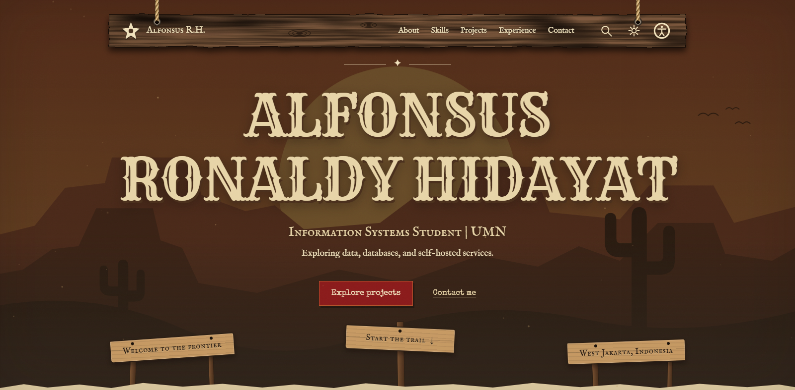

# Dusty Trail Portfolio

The personal portfolio of **Alfonsus Ronaldy Hidayat**, an Information Systems student at Universitas Multimedia Nusantara (UMN), Jakarta. Its interests are data analytics, database management, data engineering and self-hosting.

The site is a late-1800s frontier bounty board: wooden signs and plates, parchment paper, and a desert sky that turns from dawn to dusk. It is plain HTML, CSS and JavaScript ES modules, with no build step and no dependencies to install.



## Sections

- **Hero**: a layered SVG desert with mesas, sun, cactus, birds and a tumbleweed. A short saloon-door intro plays once. Three wooden trail signs at the foot of the hero carry a greeting, a link down the trail and the location. Each sign sways when hovered.
- **Education**: the UMN logo and degree details on a wooden plate, with a "Semester 5" stamp, beside an interactive 3D model of the UMN campus. The model never spins by itself; it turns when dragged.
- **Traveler's Journal**: the profile summary, a character illustration of a database rack in a cowboy hat, and a CV download button.
- **Gear & Skills**: the skill ledger by category.
- **Wanted Board**: the projects as wanted posters that flip to show the story behind each one.
- **The Trail So Far**: experience as a route on the map.
- **Contact Me**: round icon links for email, GitHub, LinkedIn and the CV, plus a message form.

## Features

- **3D campus model.** A Blender model of the UMN campus, rendered with Google's `<model-viewer>`. The mesh is Draco-compressed to about 229 KB (from 2.36 MB). Every device first shows a small still image. Desktops with WebGL then load the viewer when the section approaches. Phones, touch screens, data-saver connections and browsers without WebGL keep the still and offer a **Load the 3D campus** button, so nothing heavy downloads unless the visitor asks.
- **Sheriff's Quick-Find.** Opened with the header magnifier, `Ctrl`/`Cmd`+`K` or `/`. It filters sections, projects and contact links; arrow keys move, `Enter` goes, `Esc` closes. Choosing a project scrolls to its poster and flips it.
- **Dawn and dusk.** A sun/lantern button in the header switches the theme. With no saved choice it follows the device's light or dark setting.
- **Accessibility panel.** Dusk mode, reduced motion, high contrast and text size from 100 to 125%, saved in the browser. The device's reduced-motion setting always wins. Wooden plates and signs keep their own colours and meet text contrast in every mode.
- **Readable by default.** Body text sits on wooden plates or parchment, headings never wrap mid-word, and keyboard focus is clearly visible on every control.
- **Works without JavaScript** for the landscape, navigation and campus still. Personal content and the form need JavaScript.

## Built with

| Area | Tools |
|---|---|
| Markup, style, script | HTML5, CSS3, ES modules (no build) |
| Motion | GSAP 3.12.5 and ScrollTrigger (jsDelivr, version-pinned) |
| 3D | Blender, glTF Transform (Draco), `<model-viewer>` 4.0.0 |
| Type | Rye, IM Fell English, IM Fell English SC, Special Elite (Google Fonts) |
| Form | Formspree (optional) |
| Hosting | Vercel (static) |

## Project layout

```text
.
├── index.html
├── site.webmanifest
├── check.mjs                 content and asset validator (Node, no packages)
├── assets/
│   ├── css/                  style.css, animations.css
│   ├── js/                   data.js (all content), main.js, particles.js, cursor.js
│   ├── img/                  project previews, UMN logo, campus stills, social card
│   ├── icons/                favicon.svg, apple-touch-icon.png, icon-192.png, icon-512.png
│   ├── models/               umn-campus.glb (Draco-compressed)
│   └── cv.pdf
└── .github/workflows/deploy.yml
```

## Content

All text, links and images come from one file, `assets/js/data.js`: name, summary, education, skills, projects, experience and contact details. `main.js` renders it into the page and never inserts it as raw HTML. Empty values (CV, social links, demo links, audio) are left out of the page and out of Quick-Find.

The contact form posts to a Formspree endpoint set in `contact.formEndpoint`. Until one is set the form is shown but does not send.

## Running locally

ES modules need HTTP, so the page cannot be opened from `file://`.

```bash
python -m http.server 8080
```

Then open `http://localhost:8080/`.

## Checks

`check.mjs` needs only Node.js 18 or newer:

```bash
node check.mjs
```

It validates the data shape, anchors and ARIA references; that every referenced file exists (images, icons, manifest, CV); that the campus model is Draco-compressed and at most 300 KB; that nothing sets `auto-rotate`; that model-viewer is pinned and loaded only from `main.js`; and that no `<h2>` contains a `<br>`.

`node check.mjs --sync-meta` copies the title, description and Open Graph tags from `data.js` into `index.html`, for crawlers that do not run JavaScript. It needs `seo.url` to be set first.

## The 3D campus model

The model was built in Blender from photographs and a scale replica of the campus: the three towers, the connected main building, the bridge between buildings B and C, the front road, a small car park and limited trees, all on a compact base. It uses 30 solid-colour materials and no textures, and the UMN logos are real geometry so they stay readable.

The 2.36 MB export is compressed with:

```bash
npx @gltf-transform/cli@4.5.1 draco in.glb out.glb
```

`out.glb` becomes `assets/models/umn-campus.glb`. `gltf-transform optimize` is avoided because its defaults add a palette texture. The stills `assets/img/umn-campus.webp` and `umn-campus-600.webp` are rendered at the viewer's starting camera (`camera-orbit="-25deg 65deg 68%"`) so the swap from still to model does not jump.

A Draco model needs the Draco decoder, which `<model-viewer>` fetches from `www.gstatic.com`. If that or the viewer script is blocked, the still stays and the caption reads "3D view unavailable".

## Deployment

The site is static, so Vercel needs no build: import the repository, set the Framework Preset to **Other**, leave the Build Command empty and set the Output Directory to `.`. `.vercelignore` keeps `README.md`, `check.mjs` and `.github/` out of the deployed files. Once the production URL is known, it goes into `seo.url` and `node check.mjs --sync-meta` updates the page's meta tags.

A manual GitHub Pages workflow is also included (`.github/workflows/deploy.yml`).

## Credits and licences

- Code, CSS, SVG artwork and icons: [MIT](LICENSE).
- Fonts: [Rye](https://fonts.google.com/specimen/Rye), [IM Fell English](https://fonts.google.com/specimen/IM+Fell+English), [IM Fell English SC](https://fonts.google.com/specimen/IM+Fell+English+SC) and [Special Elite](https://fonts.google.com/specimen/Special+Elite), served by Google Fonts under the SIL Open Font License or the Apache licence shown on each specimen page.
- [GSAP and ScrollTrigger](https://gsap.com/) under GSAP's [standard licence](https://gsap.com/community/standard-license/).
- [`<model-viewer>`](https://modelviewer.dev/) by Google (Apache-2.0) and [Draco](https://google.github.io/draco/) by Google (Apache-2.0). Compression with [glTF Transform](https://gltf-transform.dev/) (MIT).
- [Formspree](https://formspree.io/): optional third-party form service.
- The campus model and its stills are the author's own work.
- The Universitas Multimedia Nusantara name and logo (`assets/img/umn-logo.png` and the logo on the model) are trademarks of UMN. They identify the author's university, fall outside the MIT licence and imply no endorsement by UMN.
- `assets/img/gate-preview.webp` is from [GATE_PROJECT](https://github.com/amaliacalista26/GATE_PROJECT). `assets/img/proxmox-preview.webp` is a cropped screenshot of the author's homelab dashboard. `assets/img/song-preview.webp` is the README of the song-classification project. Marks shown in them belong to their owners.
- No music, sound effects or assets from any western game or film are included. The look is inspired by classic westerns in general and is not affiliated with or endorsed by anyone.
